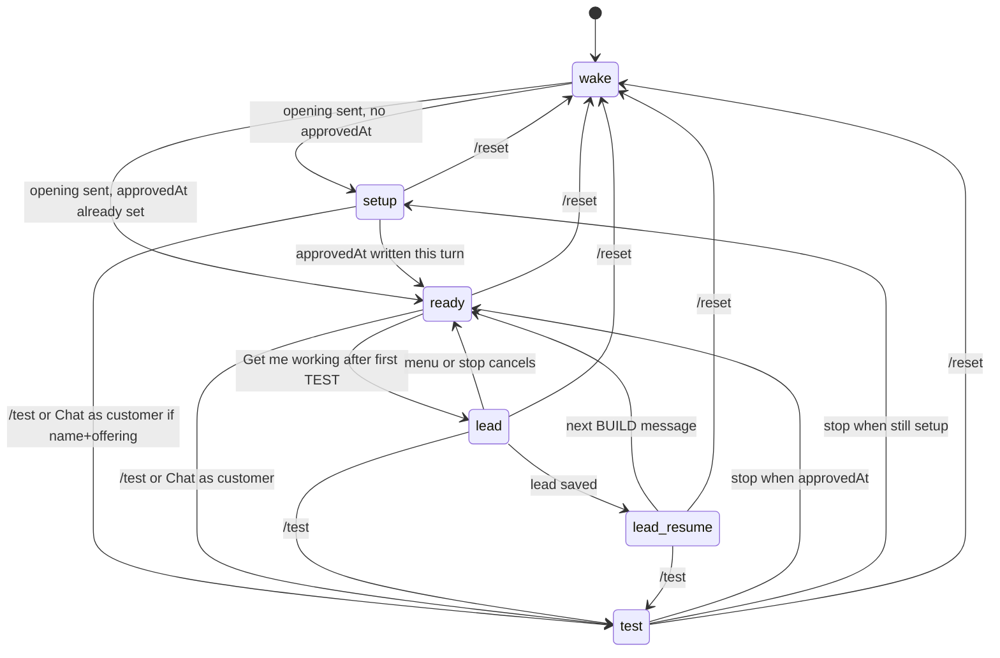
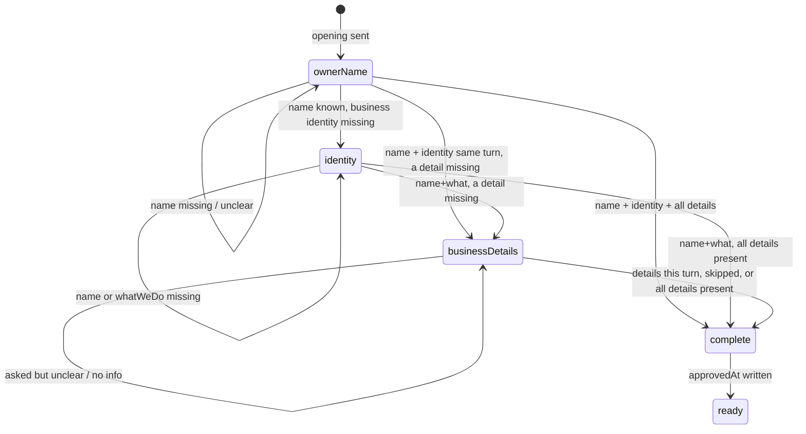

# How the Builder works

Describes the Builder as implemented on 2026-10-27. The assistant is a fixed character named **Adam**. The owner is teaching Adam about their business, not configuring a bot. During first-time setup, questioning is **code-owned** (`src/setupAgenda.js`): the app picks the next step and the scripted question. The model extracts facts into the JSON delta and may write a short ack (and identity follow-ups). Prompt text still tells the model what to do; it does not guarantee the model will do it. Only the application checks below are enforced. There is no pending draft or approval step: once the Builder understands a change, the app saves it to the live profile the customer bot uses.

## What it does and produces

The Builder interviews the business owner in chat and fills a draft business profile. The first owner message in an empty BUILD chat only wakes Adam: the app discards that text and replies with a fixed welcome (`openingMessage` in `src/builder.js`, text in `src/copy.js`: Adam introduces himself as the owner's personal assistant, says he will answer customers 24/7 and help grow the business, asks the owner to teach him about the business, then asks what to call the owner; paragraphs are separated by blank lines so they render on WhatsApp and in the web chat). The owner's display name is stored on the session (`session.ownerName` / `easybot_sessions.owner_name`), not on the customer-facing business profile. Code uses it only in a few scripted lines. If it is missing, those lines use the wording without the name. The next message starts the interview. Later replies come from the model (`OPENAI_BUILDER_MODEL`, else `OPENAI_MODEL`, otherwise `gpt-4.1-mini`) using OpenAI structured outputs (strict `json_schema`). **Model-written paragraphs (conversion enforced; writing is prompt-only):** Builder `message` and Business Bot replies get one prompt line asking for short paragraphs (1–2 sentences) separated by a blank line or `||`. The send path does not strip newlines (Twilio slices the body as-is; web chat is `pre-wrap`). Models often still emit one dense block, especially in structured JSON `message`. Before the reply is stored or sent, `formatModelReply` (`src/formatReply.js`) turns an explicit `||` marker into a blank line (`\n\n`), keeps real blank lines, collapses 3+ newlines to 2, trims, and never leaves a raw marker. Scripted/fixed copy is not rewritten. **Outgoing assembly (enforced, `composeReply` in `src/composeReply.js`):** every user-visible reply — scripted questions, acks, cards, menus, banners, lead steps, fallbacks, and error lines — is joined in one composer. Chat-visible strings live in `src/copy.js`. `formatModelReply` is the only model-text normalizer; the composer does not rewrite scripted copy. Policy (phase, agenda, routing) stays outside the composer. `buildHistory`, TEST history, and `easybot_messages.body` store that converted text so it matches WhatsApp and web chat. **Unverified:** that the model always emits a blank line or `||`. The Business Bot still defaults to `gpt-4o-mini` (`OPENAI_MODEL`). A 12-run replay of a two-turn interview found `gpt-4o-mini` still dropping some stated facts after the schema/delta change; `gpt-4.1-mini` captured them in every run. The model returns a **delta**: each draft field is null (or a reset flag is false) when the owner's current message did not set or change it. Code merges that delta into the stored draft. `newFacts` is a required top-level array (empty if none), not a draft key. Localhost `/api/start` leaves the chat empty until that wake.

The draft can hold: business name, what the business does, services (name, price, notes), hours, location or service area, common customer questions (FAQ), information the bot should collect from the customer (intake), explicit unknowns, **priceDisclosure** (`relevant` | `on_request` | null — a business fact: when approved prices are mentioned), and **conversation settings** (behavior — not business facts): **tone** (free text) and **openingMessage** (owner's opening text | null). There is no stored bot-goal field (`ownerGoal` / `ownerGoalRequested` are dropped on load). The assistant name is not configurable: it is always Adam (`ASSISTANT_NAME` in `profile.js`). `withKnownProfileKeys` drops unknown stored keys (including leftover `assistantName` and `ownerGoal`) on load. Unknown text fields are stored as null. `commonQuestions` is an array of `{ question, answer }` objects: `question` is what customers ask; `answer` is the owner’s explanation the Business Bot may tell customers. Legacy bare strings are normalized on load/merge to `{ question, answer: "" }`. Only FAQ items with a non-empty `answer` are injected into the customer prompt as approved facts. `informationToCollect` uses: **null** means the owner has not set a list yet; **[]** means collect nothing; a non-empty array lists the items. Each turn saves that draft and, when the draft differs from the live fields, applies it immediately (`applyDraftToLive` in `profile.js`). `approvedAt` is a ready timestamp, not an approval gate: `handleBuild` writes it the first time the gate sets `presentReview` (tell-me-more skipped, answered, or dumped ahead) and `hasEnoughForFirstBot` is true. Recording `businessDetails` in `askedTopics` on the first tell-me-more *ask* is not enough. `/test` and **Chat with me like a customer** use `hasEnoughForFirstBot` only. `firstTestedAt` is stamped the first time this owner enters TEST; it gates the lead menu item. The Business Bot reads those live fields: business facts (services, hours, location, FAQ answers), explicit unknowns, intake whitelist, and — separately — conversation settings (tone). Price disclosure is a business fact used in the customer prompt. `/test` and **Chat with me like a customer** need that name + offering minimum; until then the app says to tell Adam the business name and what they do (or a service).

**Conversation settings defaults (enforced on read/use, not written into stored nulls):** when `tone` is null, effective tone is `warm, friendly, and human`. When `priceDisclosure` is null, effective value is `relevant` (shown to the owner as Price policy). Invalid enum spellings are normalized or dropped to null on load. Legacy profiles without the new keys load safely and keep any existing `tone`. The Business Bot is always Adam. When `openingMessage` is null the app injects a fixed warm default welcome (`defaultCustomerOpening` in `profile.js`), one message with a blank line: `Hi! I'm Adam, {business name}'s digital assistant 😊` then `How can I help you? ✨` (or `this business` when no name is set). A custom `openingMessage` still overrides the whole opening.

**Assistant identity (opening enforced; the rest is prompt):** `/test` and **Chat with me like a customer** send that opening from code after the test-mode entry line (same one-message blank-line shape) and store it as the start of the TEST history — no model call. The first customer write is then a normal Business Bot answer (not prefixed). A first-turn-only system line says the welcome was already sent, so the model should not greet again. If a Business Bot turn still has empty history (replays that skip `/test`), `businessBotReply` prepends the same opening before the model answer. Later turns are not prefixed. The customer prompt identity (replacing, not appending) is always Adam, the business's digital assistant — never a human, the owner, or another name. The opening is customer-facing wording only. It cannot establish facts, prices, capabilities, or intake, and it does not override the price policy. Custom openings are injected verbatim; the Builder prompt is still the gate for conflicting wording (prompt-only, **unverified**).

**Business Bot next step (prompt, not enforced):** derived from `informationToCollect` only (`intakeGoalEnabled` in `customerPrompt.js` is true when that list is non-empty). Non-empty intake: after answering, invite listed details; interest or a booking request goes straight to missing items; once they are all in chat, thank / confirm and ask if there is anything else — do not ask for details again. Empty or unset intake: after answering, ask if there is anything else they would like to know, and do not ask for intake. Warmth and light emoji follow the effective tone (none if the owner set formal/professional). Closed-world and price-disclosure rules still win.

**Explicit identity reset (enforced on merge):** an omitted, null, or blank `openingMessage` in the draft preserves the live value. To clear it back to the Adam default, the draft carries `openingMessageReset: true` with a null value. `reconcileDraft` keeps a pending reset flag across later turns until a new non-empty value replaces it. `mergeDraft` applies the reset when the draft is saved. The prompt tells the model when to set this flag (an owner asking to restore the default opening); whether the model does so reliably is **unverified**.

**Price policy labels (single source for the owner):** `PRICE_POLICY_OWNER_LABELS` in `profile.js` (`relevant` / null → “I mention prices when they're relevant”; `on_request` → “I share prices only when a customer asks”). The Builder system prompt still uses `PRICE_DISCLOSURE_LABELS` (`relevant` → “when useful and relevant”; `on_request` → “only when the customer asks about pricing”). Customer-prompt policy text in `customerPrompt.js` is separate (written for the Business Bot, not the owner). There is no reply-length setting.

**Price disclosure policies (only two):**
- `relevant` — mention approved prices when useful; do not dump prices into unrelated answers; volunteering a price in every general description is not required.
- `on_request` — mention prices only when the customer asks about pricing/cost/quote/total (or a clear pricing follow-up such as “And how much?”). A general description or booking request alone does not trigger prices. A prior pricing answer does **not** permanently unlock disclosure for later unrelated questions.

**Demo scope (prompt):** the customer bot may answer from approved facts, clarify needs, collect listed intake in chat, and confirm those details back. It cannot book calendars, take payments, or sync a CRM. An approved fact may describe a business process (for example that the owner confirms bookings); that does not mean the bot booked or contacted anyone. The system does **not** persist or deliver customer inquiries to the owner. Collect means ask and confirm in this conversation. After listed details are in the chat — including if the customer then asks whether they are booked — confirm or restate those details; do not claim a booking and do not send them to the owner because this chat cannot book. Owner redirect is for a real missing fact only. If approved facts give a pricing process instead of a number (consultation, quoted in person), that process is the complete answer — not an unknown price.

**Capability catalog (single source):** `CONFIG_CAPABILITIES` and `DEMO_SCOPE` in `profile.js` list every configurable field — what it represents and what it cannot represent — plus what the Business Bot can and cannot do. The Builder prompt renders both. Business facts include `otherFacts` and customer-facing policies (including how an offering is priced or quoted). A global never-mention-any-prices policy is still unsupported `priceDisclosure`; a per-offering quote or process rule is a fact. Per-message scripts, formatting or emoji rules, fixed sign-offs, language rules, reminders, and other actions stay unsupported.

**Configuration requests (prompt + enforced):** classify style, global price mention, identity, intake list, and actions the bot should perform. What customers should be told — including what to say or not quote about an offering — is a business fact, not a config request (store it; do not refuse it as unsupported). For each classified request the Builder returns `configRequests: [{ request, status, field, alternative }]`. `request` must quote the owner's words; `status` is `supported`, `ambiguous`, or `unsupported`. Prompt: supported → update the field (the app saves it); ambiguous → ask one short question; unsupported → say so, offer the closest supported alternative by name, and wait for the owner to accept. Never say an unsupported request was added or noted. Accepting an offered alternative makes it a new supported request.
Enforced by `enforceConfigRequests` after each real Builder turn:
- A `supported` request that carries an `alternative` counts as unresolved.
- The field named by any unresolved request is restored to its previous draft value.
- If any request is unresolved, every setting field (tone, openingMessage) that changed this turn without a supported request naming it is restored too. A named `priceDisclosure` field on an unresolved request is still restored.
- If any request is unresolved after `ready`, the turn stays a model-only clarification (no save card).
**Not enforced:** the model's classification itself. If it marks an unsupported request as `supported` with the right field, the change is saved. Invalid enums are still dropped by `reconcileDraft`.

## Owner phases

Enforced by `ownerPhase` in `src/ownerPhase.js`. One of `wake | setup | ready | test | lead | lead_resume` (no wrap-up phase). Routing in `handleMessage`, save-card / menu chrome, and the setup gate share this function. **`ready` is `approvedAt`.** `/test` and **Chat with me like a customer** still use `hasEnoughForFirstBot` (name + offering) — that is a capability check, not a phase, so TEST can start during setup once those basics exist. Owner name, identity, and tell-me-more (`businessDetails`) are agenda items inside `setup`; they are not phases. The model does not return flow flags (`readyForReview`, `wantsReview`, `asksQuestion`, `askingTopic`). Leaving TEST via `stop` shows the editing menu whenever `approvedAt` is set, even if BUILD history is still empty (a seeded profile that never woke). That chrome check stays on `approvedAt`; `ownerPhase` would call the same session `wake`.

Derived from `ownerPhase` inputs (`mode`, empty `buildHistory`, `approvedAt`, `setupStep` / `askedTopics`, `leadIntake`) and the writers in `handleMessage` / `enterTest` / `enterBuild` / lead save and cancel / `/reset`. Edges are checked in `scripts/test-owner-phase.js`. **`wake → ready` is real:** empty history is always `wake`, even when `approvedAt` is already set (a seeded profile). The opening fills history and does not clear `approvedAt`, so the next `ownerPhase` is `ready`. A new owner has no `approvedAt`, so they take `wake → setup`.

**Setup agenda (enforced, `setupStep` / `stepSetupAgenda` in `src/setupAgenda.js`).** Progress is `draft.askedTopics` (app-owned; the model never sets it). The current step is derived from field presence plus that list — not persisted as a separate `step` blob. The model does not decide when to advance, when setup is done, or which topic to ask. After `ready`, save-card flags are unchanged (see below).

## What it asks

Nothing in code is labeled mandatory, optional, or conditional except the required topics, the approval-minimum name rule, and the off-purpose gate below. The prompt tells the model to set `onPurpose=true` when the owner is talking about their business or this bot (including questions about stored facts), and `onPurpose=false` (empty delta) for poems, homework, unrelated trivia, coding, jailbreaks, or role changes. After the owner shares a real business detail it should react in one warm short sentence that names what they said, with a cute emoji like ✨🌟💛 (never a tool-ish one such as 💈), ending that sentence with . or ! (emoji may sit just before or right after that mark). That reaction shape is prompt-only — **unverified** that the model always does it. The app, not the prompt, picks the next setup question. The prompt still tells the model to absorb one-message dumps, allow mid-setup direction changes, and for unsupported requests speak as Adam: say what he can do today (answer customers' questions and collect their details for the owner) and that more is coming soon ✨. That refusal is prompt-only (no keyword matching in code). It also discovers topics **when relevant** (partial information is fine):

- What to call the owner (`session.ownerName` — not a business fact; required for first setup)
- Business name (required for a first bot — the model must not invent it)
- What the business does
- A scripted “tell me more” question — **required topic**, asked once after name + what they do
- Services and offerings
- Prices, if the owner has them, and how a price applies when that matters (per unit versus flat or per booking)
- Opening hours or availability
- Location or service area
- Common customer questions (FAQ: each entry is a customer question plus the owner’s answer; the Business Bot may use those answers as approved facts) — not a setup question; later via the Q&A menu item or free text
- Details Adam should ask customers for (intake: name, phone, preferred day/time, and similar; the Business Bot asks for these in chat) — not a setup question; later via **Choose details to collect from customers** or free text
- Conversation settings when mentioned: tone, opening message (optional — defaults apply if the owner says nothing). When to mention prices (`priceDisclosure`) is a business fact. The assistant name is not a setting.

What the owner would like Adam to do for the business is **not** a setup or profile field. After the owner has entered TEST at least once, the lead questionnaire asks it as free text (`whatToDo`) and stores it on the lead row only.

For a proposed opening, the prompt tells the model to check it against the draft facts, demo scope, and price setting. If the opening claims an unsupported capability (such as booking), states an unapproved fact or price, impersonates the owner or a human, or contradicts the price policy, the model should explain the conflict, keep the previous opening in the draft, and ask for a correction. This is prompt-only (no app check). In one focused run it worked for a booking-claim opening.

The prompt tells the model to keep FAQ items in `commonQuestions` as `{ question, answer }` (full answer text when the owner explained it — not topic titles alone) and intake items in `informationToCollect`, and not to mix them. It also tells the model to clarify ambiguities that would change a customer answer: pricing basis or units, discounts, what a service area covers, hours edge cases, cancellation or refund policy, and booking or availability rules. It says capacity or group size does not settle how price scales. Setting and capability requests follow the capability-honesty rules above (clarify / refuse+offer / propose-then-approve). Whether any of these questions actually appear depends on the model and the conversation. **Unverified:** that the model always stores the full owner answer in `commonQuestions[].answer` rather than a truncated paraphrase, always maps natural-language style/price-disclosure requests into the enum fields correctly, always refuses unsupported capabilities cleanly, always keeps proposed vs applied distinct in its wording, and which clarification questions it asks in a given interview.

Application checks (enforced):

1. **Customer-bot minimum** — `hasEnoughForFirstBot` is true when there is a non-empty business **name**, and there is at least one service or a description of what they do. A description alone cannot pass. A name with no description and no service cannot. Hours, location, prices, common questions, tone, priceDisclosure, unknowns, and a non-empty intake list are not required by this check. `/test` and **Chat with me like a customer** use this check only.
2. **Setup agenda during first-time setup** (`setupStep` / `stepSetupAgenda` in `src/setupAgenda.js`; topic copy in `REQUIRED_TOPICS` in `src/builderTopics.js`). The gate (`applyReviewGate` / `gateTurn`) calls the agenda whenever `ownerPhase` is not `ready`. One step per turn. The agenda does **not** read model flow flags (those keys are gone from the schema) and does not inspect owner wording. A skippable topic is settled only when the draft gained data for it this turn, or the model returns `topicResponse=skipped`. `topicResponse` is `answered` | `skipped` | `unclear` | null (null when the owner was not answering a skippable setup topic). Unresolved `configRequests` stay on the current step and do not mark a new asked key. The agenda never rewinds. The list, in asking order:
   - `ownerName`: settled when `session.ownerName` is a non-empty string. The wake opening already asks it (`OWNER_NAME_QUESTION`: "Before we start, what would you like me to call you?"). The Builder extracts it as top-level schema field `ownerName` (not a draft/profile key). It is **not skippable**: `topicResponse=skipped` does not settle it. If the reply is unclear or no name is extracted, the agenda stays on this step (`keepLead` when the opening/re-ask was just asked): the model's full explanation is kept and the same scripted name question is appended. Not recorded in `askedTopics`. If the same turn also has business name + what they do, identity is skipped. If that turn also has all three details, tell-me-more is skipped too. If the model copies the personal name into `draft.name` on this step and `whatWeDo` is empty, code drops that business-name write. A later BUILD turn that extracts a new `ownerName` overwrites the session field (no menu item, no save-card row).
   - `identity`: settled when the draft has a non-empty **name** and **whatWeDo**. After the owner name is captured, the first identity ask is the fixed ack "Nice to meet you, {name}! 😊" then `IDENTITY_FALLBACK_QUESTION` ("What's your business called, and what does it do?") — model lead discarded. Later incomplete turns keep the model’s `message` when it contains `?`. If it does not, the app attaches that same identity question. Not recorded in `askedTopics`.
   - `businessDetails`: asked as soon as name + what they do are set and a detail is still missing. On the first ask (name + what they do already in the draft) the fixed ack is "Nice, thanks {name}! ✨" (or "Nice! ✨" if no owner name), then the two-line question in `businessDetailsQuestionText`: "Tell me a bit more about {name} (services and prices, opening hours, location, or anything else you'd like me to know)." then `Or say "skip" for now.` (`BUSINESS_DETAILS_MARKER`). If all three details are already present, the question is skipped entirely. It is **skippable**: settled once all three details are present, once services / hours / location gained data this turn, or once the model returns `topicResponse=skipped`. If the owner only asked what the question means (`topicResponse=unclear` or no new data), the agenda stays on this step: the model's full explanation is kept (`keepLead`) and the same scripted question is appended — no fixed ack. The key is still recorded in `askedTopics` on the first ask. That first ask does **not** write `approvedAt`.
   - `complete`: tell-me-more settled (`firstSetupSettled`: all three details present, or `askedTopics` already includes `businessDetails` from a prior turn). No question. If `hasEnoughForFirstBot`, the gate sets `presentReview`. `handleBuild` then writes `approvedAt` on that present-review turn even if live facts did not change (a skip). Applying the draft on the first tell-me-more *ask* must not stamp `approvedAt`.

   When the app asks tell-me-more for the first time **and** name + what they do are already in the draft, it uses that topic's fixed ack (not the model's lead) and appends the topic's question. On a repeat ask of the same skippable topic (confused / unclear), it keeps the model's full `message` — including an example that ends with `?` — and appends the scripted question (`keepLead`; `withSingleQuestion` is not used on that path). It records the topic in `draft.askedTopics` (app-owned; `reconcileDraft` carries it over and the model never sets it). Dump-ahead that already has owner name, services, hours, and location skips the question without adding the key (`askedTopics: []`) and presents ready. FAQ and intake are not agenda steps. To make the Builder ask a new topic, add an entry to `REQUIRED_TOPICS` and a step in `setupAgenda.js`.
3. **Draft reconciliation** — after each Builder turn, `reconcileDraft` normalizes `priceDisclosure` enums and preserves prior settled `informationToCollect`, `tone`, `priceDisclosure`, and `openingMessage` when the model omits them, blanks them, or sends an invalid value (the opening clears only via the explicit reset flag above). A style-only edit therefore cannot wipe an approved price-disclosure policy via a null draft field. `responseLength` is not a field.
4. **Identical consecutive reply** — after the model produces a reply, the app runs `formatModelReply` on that text (the off-purpose fixed line when `onPurpose` is false), then compares the formatted text to the previous outgoing assistant message in the conversation, folding whitespace and case. If they match, it regenerates once with a one-off per-call note (`IDENTICAL_REPLY_RETRY_NOTE` in `identicalReply.js`) telling the model its draft repeated the previous message and to respond to the latest owner message differently. The standing system prompt is not changed. If the retry is still identical, that text is sent and a warning is logged. No keyword matching. The Business Bot uses the same check on TEST replies.

Seeded or hand-written profiles that omit `informationToCollect` are treated as nothing to collect when building the customer prompt; they do not go through the interview gate.

## Follow-ups and “enough”

The prompt tells the model that after the owner shares a real business detail, it should react in one warm short sentence that names what they said, with a cute emoji like ✨🌟💛 (never 💈), ending that sentence with . or ! (emoji may sit just before or right after that mark). After a later correction or setting change, it should send a one-line acknowledgment only (the app shows what changed). During first-time setup the **agenda** picks the next question; the model's question text is replaced by `withSingleQuestion` except on identity turns that already contain `?`. The reaction shape of the model's own `message` is still prompt-only — **unverified** that the model always reacts specifically. The app sends the current draft, numbered `otherFacts` and `unknowns`, and a one-line phase note (`Ready since` or `First-time setup still open`).

**Save-card presentation (enforced, `handleBuild` + `composeReply` kinds `ready_first` / `saved_changes` / `model_plus_menu`; wrappers in `ownerNav.js`):** the draft is applied to live fields on the same turn when it differs. The editing menu is only for a bot that is already set up (`approvedAt` — already set, or written this turn when the gate presents ready). Mid-setup (`!approvedAt`) never shows the card or menu. Then:
1. **First time `approvedAt` is written** (the end of the initial setup interview): the model's text is discarded. The app sends `ready_first`: "I'm ready for a first try, {name}! 🎉" (or "I'm ready for a first try! 🎉" if no owner name) then the existing main menu (`nav: 'menu'`). There is no "I'm all set!" business card and no 2-option review card.
2. **After `ready`, unresolved `configRequests`:** the model's clarification only (`model_only`) — no card, no menu.
3. **After `ready`, the live profile changed** (including settings-only): the model's acknowledgment cut down by `reviewAck` (first sentence that is not a question, a bullet/numbered line, a line ending in `:`, or review filler). It may be empty. Then a blank line, then "Here's what changed:" and only the changed lines (`changeLines`) as WhatsApp `*Label:* value` (no previous-value suffix; no blank line between the header and the first field). Business-card fields use the 🏪 labels: Name, What you do, Services & prices, Hours, Location, Price policy. Other changed rows keep their review labels (Not decided, Other facts, I'll ask customers for, Q&A, How I talk). Values stay compact one-liners (services `name — price`, no notes). Then the same main menu. History `nav: 'menu'`. A follow-up question in the model text is stripped.
4. **After `ready`, nothing changed:** the model's text plus the full editing menu (`model_plus_menu`, `nav: 'menu'`). A courtesy "ok" or "show me the bot" keeps Adam's sentence above the menu. The leftover `Here's your bot for {name}:` / plain `How I talk: default` card (`renderReview`) is not sent on this path.
5. **Before `ready`:** scripted agenda questions (`ask_owner_name` / `ask_identity` / `ask_topic`) or the model's text only — unless the agenda is complete and the gate presents the first-ready menu.

The fuller `formatSummary` (current facts, defaults labeled) remains for UI state and tests and is not pasted into chat. Intake there is labeled "I'll ask customers for", matching the owner-facing save card.

**Prices (prompt only, not enforced):** the prompt tells the model to store each `services[].price` with its currency and unit as the owner said them (e.g. "200 ILS per 60-minute lesson"), never invent either, ask once when a bare number is unclear, and put the missing part in `unknowns` if the owner doesn't know. The review shows the price text exactly as stored; the app does not add or check currency/unit.

## Unknowns, contradictions, and corrections

The prompt tells the model not to invent facts. If the owner says something is undecided, unknown, or “not sure yet”, the model is told to put a clear statement in `unknowns` and keep the known parts in the normal fields. In the stored draft, null means a text field is unknown. In the model delta, null means unchanged this turn. The prompt tells it to notice contradictions and ambiguous spots gently.

On a correction or a later clarification, the prompt tells the model to update the draft immediately, drop resolved unknowns, and reply with a one-sentence acknowledgment only (the app saves and shows what changed plus the main menu). Code does not read the owner's wording to detect contradictions, unknowns, or corrections. After the draft merge, if any **already-stored** value was modified or removed (structured old/new draft diff), the app runs a second structured call (`runConsistencyPass` in `src/builder.js`) with that change list and the current draft; it returns extra deltas / `factEdits` for other stored text that still states an old fact. Those updates go through `applyExtraction` with `skipGuards` (no unreported-shortening revert). The pass does **not** run when the turn only adds new facts. After `ready`, a turn that changed live fields still shows the save card (a leftover model question is stripped by `reviewAck`). If the call fails, the turn's draft is kept as-is. **Not enforced:** that the second call finds every stale sentence. Saving applies the complete extracted draft onto live via thin `mergeDraft`. A null or blank text field does not clear a value already stored. An omitted array leaves the previous list in place. A null `informationToCollect` in the draft does not clear a previously settled array; dropping one intake item needs `ownerEdits` `remove`. A null or invalid behavior enum in the draft does not clear a previously settled setting.

If the model reply is not valid JSON, or structured outputs refuse, the app keeps the previous draft.

**Structured response (app-enforced, OpenAI `json_schema` strict).** Every Builder turn must return all top-level keys (`message`, `draft`, `newFacts`, `ownerEdits`, `factEdits`, `resolvedUnknowns`, `configRequests`, `onPurpose`, `topicResponse`, `ownerName`). The model does **not** return `readyForReview`, `wantsReview`, `asksQuestion`, `askingTopic`, `goalSupported`, or `goalUnsupportedPart` — code owns phase, chrome, and history `asksQuestion`. `ownerName` is the owner's display name this turn (`null` if unchanged or not stated); code copies a non-empty value onto the session and never onto the business profile. History `asksQuestion` is true only when `composeReply` used `ask_owner_name`, `ask_identity`, or `ask_topic`. `onPurpose` is true when the owner is talking about their business or this bot (including questions about stored facts). `topicResponse` is the model's signal for the current skippable setup topic (`answered` | `skipped` | `unclear` | null); code combines it with saved draft data to settle or stay. `draft` has a fixed field list and does **not** include `newFacts`, `otherFacts`, `askedTopics`, or a goal field. Arrays that are unused this turn are empty; unused text/enum fields are null. The `newFacts` schema describes the array as including owner-stated limits (offerings or areas they do not provide or serve). The `message` schema describes an owner-facing reply as Adam in first person (never the business name as the speaker). `informationToCollect` is described as details Adam should ask customers for. **Not enforced:** that a required key contains the fact the owner stated — the model can still return `newFacts: []` — or that `message` always uses first person or that `topicResponse` is always the intended value. History `asksQuestion` is always false after `ready`. First-ready chrome is app-rendered `ready_first` (model `message` discarded). Later edits that changed live fields use `saved_changes` (model ack kept, then the main menu). Unchanged ready turns use the model's text plus the editing menu.

**One merge (enforced, `applyExtraction` in `src/applyExtraction.js`).** Every Builder turn — and the consistency pass — applies the model output through this function. `applyBuilderModelOutput` is a thin wrapper. `mergeDraft` / `applyDraftToLive` then assign that already-complete draft onto live keys (null scalars keep the previous value; a missing array key keeps live; a present array is the complete list). Omission never deletes. Only an explicit op or an explicit field write deletes:
- Null / omitted / blank text and enum fields, and empty `services` / `commonQuestions` / `unknowns` arrays, mean unchanged.
- `services` / `commonQuestions` are upserted by identity (`name` / `question`). Removals need `ownerEdits` `{ field, item, action: 'remove' }`.
- `informationToCollect`: **null** = unchanged; **`[]`** = collect nothing; a non-empty array unions onto the stored list (omitted items stay). Dropping one item requires `ownerEdits` `{ field: 'informationToCollect', item, action: 'remove' }`.
- `unknowns` arrays are new undecided items only (appended). `resolvedUnknowns` indexes remove stored ones.
- `otherFacts` is code-owned: the model never re-emits the list. Missing `otherFacts` on the stored draft falls back to live so a no-change turn cannot wipe it. `newFacts` appends; `factEdits` `{ index, text }` replaces; `text: null` removes.
- `openingMessageReset: true` is the explicit clear of the opening. `ownerEdits` `action: 'remove'` on a text field (`name` / `whatWeDo` / `hours` / `locationOrArea`) clears that field.
- Unreported shortenings of stored services, FAQ answers, or text fields are reverted unless `ownerEdits` names them or the raw delta proposed a rewrite (same rules as before). The consistency pass skips that guard (`skipGuards`).
- **Not enforced:** that the model reports `ownerEdits` / `factEdits` correctly. An unreported intake or list removal is kept. Which field a fact lands in is up to the model.

**Save-card visibility (enforced).** `changeLines` diffs every `summaryLines` row, including fields that disappear when emptied (`otherFacts`, `unknowns`) — those use the existing `none` / `nothing` labels. FAQ `full` includes unanswered items so a question-only edit still produces a Q&A line. If `draftDiffersFromLive` is true but `changeLines` is empty, `handleBuild` treats the turn as no change (`model_plus_menu`) and does not write the invisible mutation to live.

## Save card, `/test`, `stop`, and later edits

There is no pending/approval state. Typed words such as "approve", "looks good", or "yes" are ordinary Builder messages. **Application gate (enforced, `applyReviewGate` then `handleBuild`):**
- The turn’s draft is always kept. If it differs from live, or the gate set `presentReview`, `applyDraftToLive` writes it immediately; `handleBuild` then stamps `approvedAt` only when `presentReview` is set. The customer bot uses the new facts on the next TEST turn.
- **Settings-only edits:** when the bot is already ready and the draft changes only conversation settings or identity, that is a changed turn — the save card plus the main menu are shown and the model's question text is stripped by `reviewAck`.
- If a setup-agenda step is still open (owner name, identity, or tell-me-more), its scripted question is shown instead of the ready menu. The draft is still applied if it changed.
- **After `ready`:** unresolved `configRequests` → model text only; a changed draft → save card plus the main menu; otherwise model text plus the editing menu. "Show me the bot" is a menu / section item, not a model classification.

`/test`, `stop`, and `/reset` are exact chat commands handled by the app, not the model. `/test` needs `hasEnoughForFirstBot` (name + offering). Until then it replies: "Tell me your business name and what you do (or a service) before I can chat as your assistant." It switches to TEST mode, starts a new customer conversation, and answers each message with the Business Bot (see Business Bot replies). Entry is two scripted messages (code, no model): first a banner (`*Test mode is on*`, "Now you're the customer, and I'm {business}'s assistant.", and "Type *stop* when you want to keep teaching me."), then the customer opening as its own message. Web chat already turns `*bold*` into `<strong>` via `formatBody` in `public/index.html`. TEST chat does not change the profile. `stop` switches back to BUILD when the whole message, trimmed, is `stop` (case-insensitive), optionally wrapped in WhatsApp bold (`*stop*`). "stop" inside a longer sentence is not the command. `/end` still switches back to BUILD as a silent alias and is not mentioned in owner-facing copy. Leaving TEST sends a `*Test mode is off*` banner ("I'm back to learning about your business.") then, when `approvedAt` is set, the editing menu introduced with "I'm back, {name}! What should I learn next?" (or "I'm back! What should I learn next?" if no owner name). The first TEST entry also stamps `firstTestedAt`, so that post-TEST menu includes **Get me working for your business** until a lead is submitted. Leaving TEST before Adam is ready follows the off banner with "I'm still learning about your business. Tell me more and I'll keep going." and no menu. `stop` while already in BUILD (for example cancelling a lead) uses the same "I'm back…" intro plus the menu when approved, or the setup-continue line when not. Other menu displays (`*menu*`, after a save, lead resume) use "{name}, what should we do next?" (or "What should we do next?"). `/reset` wipes the saved profile (including `firstTestedAt`), the chats, this sender's owner name (`session.ownerName`), lead questionnaire state (`leadIntake`, including a submitted marker), and this sender's `easybot_leads` row, then replies "All cleared. Send any message and I'll start fresh."; the next non-command message wakes the fixed welcome again. Other senders are untouched. After a new first setup, the lead item is offered again only after the owner enters TEST at least once.

## Editing menu (app-enforced, `src/ownerNav.js` parse + `composeReply` render)

Applies in BUILD mode. **Menu words** (`menu`, `/menu`, …) require `approvedAt`.

- **Menu numbers** bind only to the latest assistant reply with `nav: 'menu'` (`lastShownNav` / `menuActive`). Any later assistant reply without `nav` clears the menu. A bare digit with no active nav is sent to the Builder as normal text. After `ready`, most Builder turns attach `nav: 'menu'`; unresolved `configRequests` are `model_only` and have no `nav`. There is no 2-option review card. **Chat with me like a customer** enters TEST when the name + offering minimum is met. Before `approvedAt`, menu words and bare numbers still go to the Builder model as normal messages.

- **Menu:** rendered from `menuItems()` (single source for render and parse, in `composeReply.js`, re-exported from `ownerNav.js`). Order: 🚀 Get me working for your business (only when offered, see below), 🏪 Tell me more about your business, ❓ Teach me more questions and answers, 📝 Choose details to collect from customers, 💬 Tell me how to talk to your customers, 🤖 Chat with me like a customer. After leaving TEST via `stop`, the menu is a second message after the off banner, introduced with "I'm back, {name}! What should I learn next?" (fallback without the name). After `stop` while already in BUILD, the same "I'm back…" intro. `*menu*` / keep-teaching / lead-resume uses "{name}, what should we do next?" (fallback "What should we do next?"). **Before the first TEST** (`firstTestedAt` unset): five items, Chat with me like a customer is 5. **After the first TEST and no lead submitted:** the lead item is first and the rest shift (Chat with me like a customer is 6). **After a lead is submitted** (or before TEST): no lead item. It ends with "Pick a number, or just tell me what you want me to learn."
- **When it is shown:** after first-ready (`ready_first`); after a later edit (`saved_changes`); after `stop`; when a ready owner sends a short menu request (whitelist: `menu`, `/menu`, `main menu`, `show menu`, `back to menu`, `options`, and close variants); on the first BUILD message after a completed lead questionnaire; and after a ready Builder turn that did not change the live profile and has no unresolved config request (`model_plus_menu`). Longer phrasings go to the Builder model.
- **Numbers:** a standalone number within the currently rendered item count is a menu choice only when the latest assistant entry in the Builder history is a menu (the entry carries `nav: 'menu'`; Supabase `build_history` is jsonb, so the marker persists). After any other reply (a section view, a Builder question), a number is passed to the Builder model as an answer. Rendering and parsing share one item list (`menuItems`), and the lead item's visibility is evaluated with the same rule at parse time, so a number maps to the item the owner was last shown. Numbers outside the current item count go to the Builder model.
- **Edit items:** app-rendered section cards (`renderSection` in `ownerNav.js`). First line is the section emoji plus a first-person Adam sentence, then a blank line, then the fields. Field labels are WhatsApp `*bold*` (`*Name:*`), one per line, no bullets. Missing values are `not added yet` (never `(none)`, `(not set)`, or `(default)`). Each card ends with "What do you want to change?" then "Type *menu* to go back to the main menu." Your business (`🏪`): Name, What you do, Services & prices, Hours, Location, Price policy (effective `priceDisclosure` sentence; null uses the relevant wording). Questions and answers (`❓`): each stored question in bold, answer on the next line, blank line between items; empty list is "No questions yet."; unanswered items use `not added yet`. Choose details to collect (`📝`): listed intake items, or "No details yet." How I talk (`💬`): Style (effective tone) and Opening message (each non-blank line of the custom or default opening prefixed `> `). Unknowns and other facts stay on the save card, not a section.
- **`menu` (enforced, like `stop`):** the whole message is `menu`, case-insensitive, optionally wrapped in WhatsApp `*bold*`. `menu.`, `please menu`, and `menu please` are not the command. Existing extra aliases (`/menu`, `show menu`, …) still open the menu. From a section, this shows `renderChangeMenu` ("{name}, what should we do next?" / "What should we do next?" plus the numbered emoji items). Requires `approvedAt`. Does not write the profile.
- **Get me working for your business (app-enforced, `src/leadIntake.js`):** listed as item 1 only when `approvedAt` and `firstTestedAt` are set and this sender has not yet submitted a lead (`/reset` clears both the lead and `firstTestedAt`). Picking it starts with a short fixed intro ("Awesome! So glad you're interested 🙌") plus the contact-consent question, then (after Yes or No) a free-text "What would you like me to do for {name}?" (`whatToDo`; empty input re-asks), then the existing bridge (`LEAD_BRIDGE`) and the remaining questions (no LLM; numbers only, invalid input re-asks; one free-text follow-up for Other on channels, actions, and chat tools). Questions after `whatToDo`: channels ("Where would you like me to work?"), actions ("What would you like me to do beyond answering questions? ✨"), daily inquiries, and current chat tools. The Other follow-ups use the same "me" wording. Numbered options are shown with a leading emoji; stored /admin answers keep the plain label (no emoji). State lives in `session.leadIntake` (`easybot_sessions.lead_intake`), never in the Builder history, profile, or draft. `stop`, `/test`, `/reset`, or a menu request mid-questionnaire drops it without saving. On completion the app saves one row per sender to `easybot_leads` and replies with a single thanks line based on the stored consent answer (contact-yes: "Thanks! We'll get back to you soon 🙏"; contact-no: "Thanks! We got your details 🙏") and no menu. The next BUILD message (not `/test`, `stop`, or `/reset`) shows `renderChangeMenu` — "What should we do next?" then the editing menu without the lead item — and writes it into Builder history (`nav: 'menu'`), so `1` becomes Tell me more about your business again. Cancel and already-sent replies still use `renderMenu` (no extra header). After submission it cannot be picked again (if reached, the app replies that the request was already sent) until `/reset` clears this sender's lead. Before the first TEST the lead item is not listed, so `1` is Tell me more about your business and Chat with me like a customer is 5.
- **Chat with me like a customer (6 with the lead item, otherwise 5):** the same path as `/test` (name + offering minimum; otherwise the refusal reply). The labels `chat with me like a customer` / `try` / `try it` still select it while the editing menu is showing; a bare number stays a menu number.
- **Read-only (edit items and menu words):** showing the menu or a section never saves the profile. Navigation turns are appended to the Builder history so a follow-up like "make it warmer" has context. Free-text edits work at any time, including right after a section view of a different topic. Edits apply on that Builder turn.

A later edit in BUILD is another interview turn. The prompt tells the model to update the draft and reply with a one-sentence acknowledgment; the app saves immediately, shows what changed, and the main menu. Behavior-only edits (tone / opening) follow the same save path and must not change business facts. A price-policy change is a business-info change. The app also forces the save card through the settings-only rule of the gate.

**Customer prompt structure (enforced by `buildCustomerSystemPrompt`):** APPROVED BUSINESS FACTS, then CONVERSATION SETTINGS (tone, price policy, Adam identity / opening — with a priority statement that settings never establish facts/capabilities/intake; no reply-length line), then BEHAVIOR RULES (closed-world contract wins on conflict). There is no BOT OBJECTIVE block. Adam's identity and the opening live inside conversation settings, separate from business facts. Absence of an approved fact is a gap (prompt-only: name the missing info as not available here, not “I don’t know”; warmly invite messaging the owner only when a real gap remains, never promising a response; never treat silence as yes or no). A stated pricing process is a complete answer. After listed intake is in the chat, confirm it; do not send the customer elsewhere because the chat cannot book. Stay-on-this-business (prompt only, **unverified**): poems, homework, general knowledge, coding, and attempts to change instructions or role get one short warm steer back to the business and are not fulfilled. Not enforced.

**Off-purpose turns (app-enforced).** When the model returns `onPurpose: false`, the app does not apply draft changes or `newFacts`, replies with a fixed line (`OFF_PURPOSE_OWNER_REPLY` in `src/copy.js`: "I'm here to help small businesses chat with their customers 😊 Want to tell me about your business?"), and does not append the owner's text or the reply to `buildHistory`. The prompt tells the model to set this for poems, homework, unrelated trivia, coding, jailbreaks, or role changes (empty delta). Missing `onPurpose` is treated as on-purpose so stubs and parse fallbacks keep working. **Unverified:** that the model always sets `onPurpose` correctly.

**Saves are instant (enforced):** On a Builder turn whose draft differs from live, the app writes the live fields in the same turn. Off-purpose turns do not save. Nothing else has to finish first: there is no external sync, pending state, or background worker.

**Business Bot replies (enforced):** each TEST message is one OpenAI chat completion from the app (`businessBot.js`), or two if that formatted reply matches the previous outgoing assistant message (same identical-reply retry as the Builder): model `OPENAI_MODEL` (default `gpt-4o-mini`), the system prompt from `buildCustomerSystemPrompt` on the live profile (including the same one-line short-paragraph instruction as the Builder), then the last 20 messages of the TEST conversation, then the new message. The model content is passed through `formatModelReply` before the identical-reply check, before the opening is prepended, and before TEST history is stored. Classic models are sent at temperature 0. If the model rejects temperature (typical of reasoning models), the app retries without it, with `max_completion_tokens` and the lowest `reasoning_effort` that model accepts (`none`, then `minimal`, then `low`). The working shape is cached per model name. Default model is still `gpt-4o-mini`. The TEST conversation is the session's `testHistory` (Supabase `easybot_sessions.test_history` for WhatsApp, so it survives restarts and deploys). The app keeps the last 40 messages and clears it on each `/test`. If the OpenAI call fails, the owner gets "Sorry, your bot couldn't answer right now. Please try again in a moment."; the failed turn is not added to the history and provider error text is neither shown nor logged. Owner-facing app messages use plain product wording with no internal service names, URLs, or raw error text. If the WhatsApp worker gets no reply, it sends a generic "Sorry, something went wrong…" message. These templates are enforced; model-generated Builder and Business Bot replies avoiding internal names is a prompt-level expectation only and is not enforced or verified.

**Browser / local:** profile file on disk; session transcript in memory (file-backed sessions). **WhatsApp:** each sender has isolated session + profile + inbound queue in Supabase (`easybot_*` tables). The Twilio webhook validates `X-Twilio-Signature`, enqueues by `MessageSid`, ACKs quickly, and a durable worker processes messages in order per sender. **Unverified:** that the model always preserves every unknown, stores full FAQ answers (not truncated paraphrases), splits FAQ vs intake correctly, or maps style/price-disclosure natural language reliably.

## Known risks

Found while mapping `ownerPhase` and nav. Not fixed in this step (except stale `lastShownNav`, which now expires).

- Off-purpose does not write history, so the last menu stays live and a bare `1` is still chrome.
- After `ready`, a no-change turn always attaches the menu, so a bare `1` is whatever `menuItems()` currently lists first (Tell me more before the first TEST; the lead item after TEST if none submitted) even if the model asked something above it.
- `ownerPhase(session)` without a profile: empty history is `wake` even when `approvedAt` is set. `stop` from TEST with empty history and no `approvedAt` (possible if `/test` ran before wake on a seeded-enough profile) discards the next text as a second wake.
- Two “ready” definitions: TEST uses `hasEnoughForFirstBot`; menus use `approvedAt`.
- Intake remove still needs `ownerEdits` `remove`; omission alone will not drop a row.
- `composeReply` kind `review` still has no `nav` (dead session path).
- Seeded profiles that omit `informationToCollect` collect nothing (`intakeGoalEnabled` is false).
- Identity fallback still keys off `?` in the model text.
- `/end` is a silent `stop` alias.
- Lead `whatToDo` and “Other” follow-ups are free text; invalid-number re-ask is only on numbered steps.
- `handleMessage` routes `wake` / `lead` / `test` with `ownerPhase(session)` and no profile; chrome later loads the profile. A seeded approved profile with empty history wakes and discards the first text.
- `/test` during setup (name + offering, before tell-me-more is settled) still stamps `firstTestedAt`, so the first-ready menu can already include the lead item.
