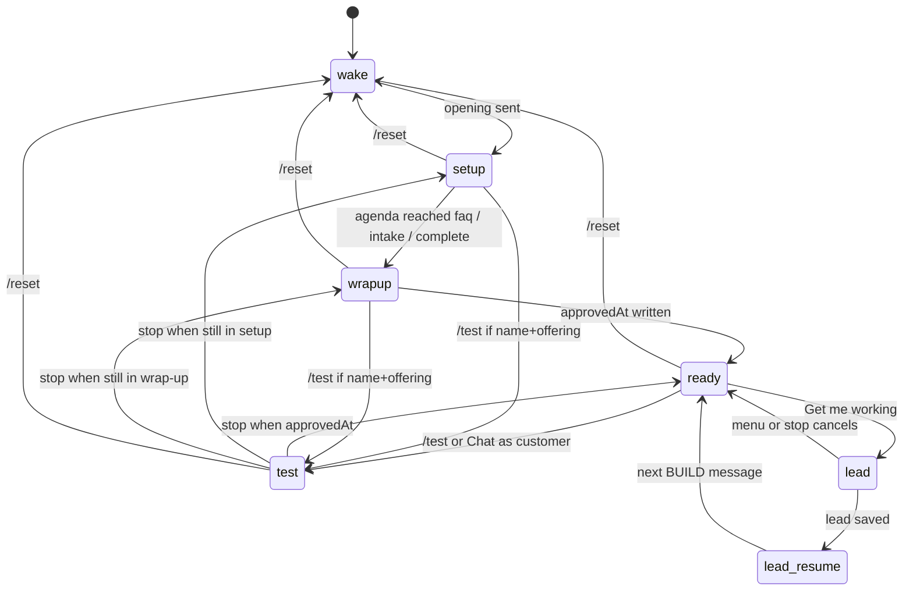
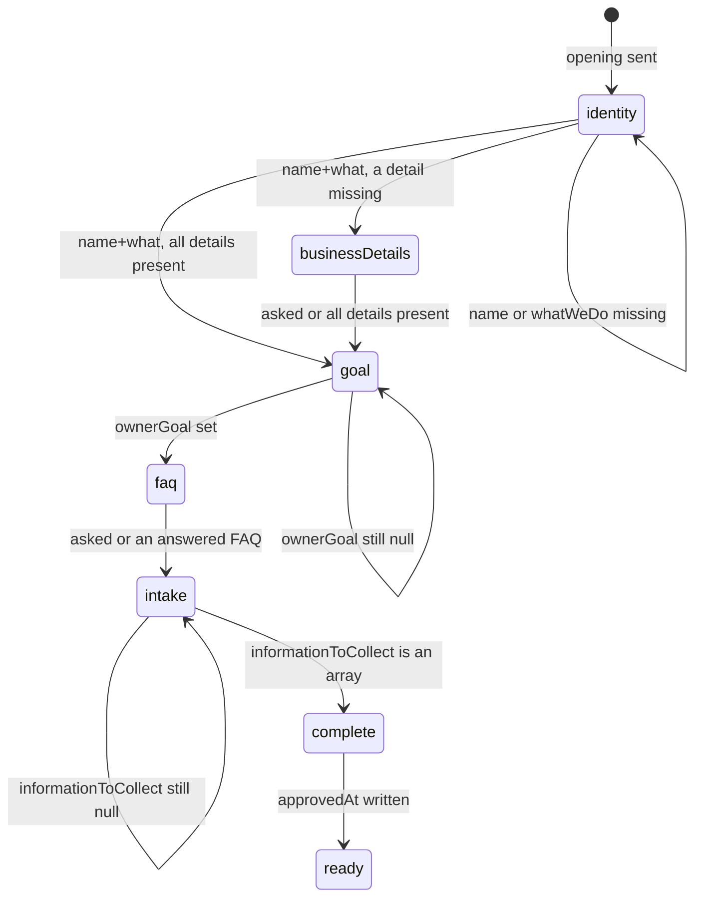

# How the Builder works

Describes the Builder as implemented on 2026-10-27. The assistant is a fixed character named **Adam**. The owner is teaching Adam about their business, not configuring a bot. During first-time setup, questioning is **code-owned** (`src/setupAgenda.js`): the app picks the next step and the scripted question. The model extracts facts into the JSON delta and may write a short ack (and identity follow-ups). Prompt text still tells the model what to do; it does not guarantee the model will do it. Only the application checks below are enforced. There is no pending draft or approval step: once the Builder understands a change, the app saves it to the live profile the customer bot uses.

## What it does and produces

The Builder interviews the business owner in chat and fills a draft business profile. The first owner message in an empty BUILD chat only wakes Adam: the app discards that text and replies with a fixed welcome (`openingMessage` in `src/builder.js`: Adam introduces himself, says he will talk to the owner's customers, asks for patience as one of the first businesses he is learning, then invites them to share the business name and what it does; paragraphs are separated by blank lines so they render on WhatsApp and in the web chat). The next message starts the interview. Later replies come from the model (`OPENAI_BUILDER_MODEL`, else `OPENAI_MODEL`, otherwise `gpt-4.1-mini`) using OpenAI structured outputs (strict `json_schema`). **Model-written paragraphs (conversion enforced; writing is prompt-only):** Builder `message` and Business Bot replies get one prompt line asking for short paragraphs (1–2 sentences) separated by a blank line or `||`. The send path does not strip newlines (Twilio slices the body as-is; web chat is `pre-wrap`). Models often still emit one dense block, especially in structured JSON `message`. Before the reply is stored or sent, `formatModelReply` (`src/formatReply.js`) turns an explicit `||` marker into a blank line (`\n\n`), keeps real blank lines, collapses 3+ newlines to 2, trims, and never leaves a raw marker. Scripted/fixed copy is not rewritten. `buildHistory`, TEST history, and `easybot_messages.body` store that converted text so it matches WhatsApp and web chat. **Unverified:** that the model always emits a blank line or `||`. The Business Bot still defaults to `gpt-4o-mini` (`OPENAI_MODEL`). A 12-run replay of a two-turn interview found `gpt-4o-mini` still dropping some stated facts after the schema/delta change; `gpt-4.1-mini` captured them in every run. The model returns a **delta**: each draft field is null (or a reset flag is false) when the owner's current message did not set or change it. Code merges that delta into the stored draft. `newFacts` is a required top-level array (empty if none), not a draft key. Localhost `/api/start` leaves the chat empty until that wake.

The draft can hold: business name, what the business does, **ownerGoal** (the bot goal: `answer_questions` | `collect_details` | `answer_and_collect` | null) plus **ownerGoalRequested** (the owner's own words, kept for demo research only), services (name, price, notes), hours, location or service area, common customer questions (FAQ), information the bot should collect from the customer (intake), explicit unknowns, **priceDisclosure** (`relevant` | `on_request` | null — a business fact: when approved prices are mentioned), and **conversation settings** (behavior — not business facts): **tone** (free text) and **openingMessage** (owner's opening text | null). The assistant name is not configurable: it is always Adam (`ASSISTANT_NAME` in `profile.js`). `withKnownProfileKeys` drops unknown stored keys (including a leftover `assistantName`) on load. Unknown text fields are stored as null. `ownerGoal` stays null until the owner answers the goal question — the app never invents a goal. Any other stored value (including legacy free-text goals) is normalized to null on load, merge, and use, so it is never shown or sent to the Business Bot. `ownerGoalRequested` is copied on approval but never reaches the Business Bot or the review. `commonQuestions` is an array of `{ question, answer }` objects: `question` is what customers ask; `answer` is the owner’s explanation the Business Bot may tell customers. Legacy bare strings are normalized on load/merge to `{ question, answer: "" }`. Only FAQ items with a non-empty `answer` are injected into the customer prompt as approved facts. `informationToCollect` uses a different convention: **null** means the owner has not been asked yet; **[]** means the owner said collect nothing; a non-empty array lists the items. Each turn saves that draft and, when the draft differs from the live fields, applies it immediately (`applyDraftToLive` in `profile.js`). `approvedAt` is a ready timestamp, not an approval gate: it is set the first time the profile has a name plus offering (`hasEnoughForFirstBot`) and first-time required topics are settled (FAQ asked or answered, and `informationToCollect` is an array). `/test` and **Chat with me like a customer** use `hasEnoughForFirstBot` only. The Business Bot reads those live fields: business facts (services, hours, location, FAQ answers), explicit unknowns, intake whitelist, `ownerGoal` as one fixed BOT OBJECTIVE sentence per value (`OBJECTIVE_SENTENCES` in `customerPrompt.js`; conversational direction only, collecting is limited to the intake list), and — separately — conversation settings (tone). Price disclosure is a business fact used in the customer prompt. `/test` and **Chat with me like a customer** need that name + offering minimum; until then the app says to tell Adam the business name and what they do (or a service).

**Conversation settings defaults (enforced on read/use, not written into stored nulls):** when `tone` is null, effective tone is `warm, friendly, and human`. When `priceDisclosure` is null, effective value is `relevant` (shown to the owner as Price policy). Invalid enum spellings are normalized or dropped to null on load. Legacy profiles without the new keys load safely and keep any existing `tone`. The Business Bot is always Adam. When `openingMessage` is null the app injects a fixed warm default welcome (`defaultCustomerOpening` in `profile.js`), one message with a blank line: `Hi! I'm Adam, {business name}'s digital assistant 😊` then `How can I help you? ✨` (or `this business` when no name is set). A custom `openingMessage` still overrides the whole opening.

**Assistant identity (opening enforced; the rest is prompt):** `/test` and **Chat with me like a customer** send that opening from code after the test-mode entry line (same one-message blank-line shape) and store it as the start of the TEST history — no model call. The first customer write is then a normal Business Bot answer (not prefixed). A first-turn-only system line says the welcome was already sent, so the model should not greet again. If a Business Bot turn still has empty history (replays that skip `/test`), `businessBotReply` prepends the same opening before the model answer. Later turns are not prefixed. The customer prompt identity (replacing, not appending) is always Adam, the business's digital assistant — never a human, the owner, or another name. The opening is customer-facing wording only. It cannot establish facts, prices, capabilities, or intake, and it does not override the price policy. Custom openings are injected verbatim; the Builder prompt is still the gate for conflicting wording (prompt-only, **unverified**).

**Business Bot next step (prompt, not enforced):** derived from stored `ownerGoal` + `informationToCollect` (`intakeGoalEnabled` in `customerPrompt.js`). Collect goal with a non-empty intake list: after answering, invite listed details; interest or a booking request goes straight to missing items; once they are all in chat, thank / confirm and ask if there is anything else — do not ask for details again. Otherwise (answer-questions goal, empty intake, or unset goal): after answering, ask if there is anything else they would like to know, and do not ask for intake. Warmth and light emoji follow the effective tone (none if the owner set formal/professional). Closed-world and price-disclosure rules still win.

**Explicit identity reset (enforced on merge):** an omitted, null, or blank `openingMessage` in the draft preserves the live value. To clear it back to the Adam default, the draft carries `openingMessageReset: true` with a null value. `reconcileDraft` keeps a pending reset flag across later turns until a new non-empty value replaces it. `mergeDraft` applies the reset when the draft is saved. The prompt tells the model when to set this flag (an owner asking to restore the default opening); whether the model does so reliably is **unverified**.

**Price policy labels (single source for the owner):** `PRICE_POLICY_OWNER_LABELS` in `profile.js` (`relevant` / null → “I mention prices when they're relevant”; `on_request` → “I share prices only when a customer asks”). The Builder system prompt still uses `PRICE_DISCLOSURE_LABELS` (`relevant` → “when useful and relevant”; `on_request` → “only when the customer asks about pricing”). Customer-prompt policy text in `customerPrompt.js` is separate (written for the Business Bot, not the owner). There is no reply-length setting.

**Price disclosure policies (only two):**
- `relevant` — mention approved prices when useful; do not dump prices into unrelated answers; volunteering a price in every general description is not required.
- `on_request` — mention prices only when the customer asks about pricing/cost/quote/total (or a clear pricing follow-up such as “And how much?”). A general description or booking request alone does not trigger prices. A prior pricing answer does **not** permanently unlock disclosure for later unrelated questions.

**Demo scope (prompt):** the customer bot may answer from approved facts, clarify needs, collect listed intake in chat, and confirm those details back. It cannot book calendars, take payments, or sync a CRM. An approved fact may describe a business process (for example that the owner confirms bookings); that does not mean the bot booked or contacted anyone. The system does **not** persist or deliver customer inquiries to the owner. Collect means ask and confirm in this conversation. After listed details are in the chat — including if the customer then asks whether they are booked — confirm or restate those details; do not claim a booking and do not send them to the owner because this chat cannot book. Owner redirect is for a real missing fact only. If approved facts give a pricing process instead of a number (consultation, quoted in person), that process is the complete answer — not an unknown price.

**Capability catalog (single source):** `CONFIG_CAPABILITIES` and `DEMO_SCOPE` in `profile.js` list every configurable field — what it represents and what it cannot represent — plus what the Business Bot can and cannot do. The Builder prompt renders both. Business facts include `otherFacts` and customer-facing policies (including how an offering is priced or quoted). A global never-mention-any-prices policy is still unsupported `priceDisclosure`; a per-offering quote or process rule is a fact. Per-message scripts, formatting or emoji rules, fixed sign-offs, language rules, reminders, and other actions stay unsupported.

**Configuration requests (prompt + enforced):** classify style, global price mention, identity, goal, intake list, and actions the bot should perform. What customers should be told — including what to say or not quote about an offering — is a business fact, not a config request (store it; do not refuse it as unsupported). For each classified request the Builder returns `configRequests: [{ request, status, field, alternative }]`. `request` must quote the owner's words; `status` is `supported`, `ambiguous`, or `unsupported`. Prompt: supported → update the field (the app saves it); ambiguous → ask one short question; unsupported → say so, offer the closest supported alternative by name, and wait for the owner to accept. Never say an unsupported request was added or noted. Accepting an offered alternative makes it a new supported request.
Enforced by `enforceConfigRequests` after each real Builder turn:
- A `supported` request that carries an `alternative` counts as unresolved.
- The field named by any unresolved request is restored to its previous draft value.
- If any request is unresolved, every setting field (tone, openingMessage) that changed this turn without a supported request naming it is restored too. A named `priceDisclosure` field on an unresolved request is still restored.
- If any request is unresolved, the turn is not ready for review.
**Not enforced:** the model's classification itself. If it marks an unsupported request as `supported` with the right field, the change is saved. Invalid enums are still dropped by `reconcileDraft`.

## Owner phases

Enforced by `ownerPhase` in `src/ownerPhase.js`. One of `wake | setup | wrapup | ready | test | lead | lead_resume`. Routing in `handleMessage`, save-card / menu chrome, and the setup gate share this function. **`ready` is `approvedAt`.** `/test` and **Chat with me like a customer** still use `hasEnoughForFirstBot` (name + offering) — that is a capability check, not a phase, so TEST can start during setup once those basics exist. Tell-me-more (`businessDetails`) and the scripted goal question stay agenda items inside `setup`; they are not phases. **`wrapup` is the agenda at `faq` / `intake` / `complete`** (`setupStep` in `src/setupAgenda.js`). This-turn model flags (`readyForReview` / `wantsReview`) do not start wrap-up; the gate does not read them during setup. Leaving TEST via `stop` shows the editing menu whenever `approvedAt` is set, even if BUILD history is still empty (a seeded profile that never woke). That chrome check stays on `approvedAt`; `ownerPhase` would call the same session `wake`.

**Setup agenda (enforced, `setupStep` / `stepSetupAgenda` in `src/setupAgenda.js`).** Progress is `draft.askedTopics` (app-owned; the model never sets it). The current step is derived from field presence plus that list — not persisted as a separate `step` blob. The model does not decide when to advance, when setup is done, or which topic to ask. After `ready`, save-card flags are unchanged (see below).

## What it asks

Nothing in code is labeled mandatory, optional, or conditional except the required topics, the approval-minimum name rule, and the off-purpose gate below. The prompt tells the model to set `onPurpose=true` when the owner is talking about their business or this bot (including questions about stored facts), and `onPurpose=false` (empty delta) for poems, homework, unrelated trivia, coding, jailbreaks, or role changes, and otherwise to start with the business only (invite them to tell about the business — not a feature checklist). After the owner shares a real business detail it should react in one warm short sentence that names what they said, with a cute emoji like ✨🌟💛 (never a tool-ish one such as 💈), ending that sentence with . or ! (emoji may sit just before or right after that mark), then ask exactly one question. This reaction-then-question shape is prompt-only — **unverified** that the model always does it. It also tells the model to defer `ownerGoal` until `draft.name` is set, help vague goals without inventing `ownerGoal`, absorb one-message dumps (react specifically, then one follow-up), allow mid-setup direction changes, and for unsupported requests speak as Adam: say what he can do today (answer customers' questions and collect their details for the owner), that more is coming soon ✨, and continue with the next question. That refusal is prompt-only (no keyword matching in code). It also discovers topics **when relevant** (partial information is fine):

- Business name (required for a first bot — the model must not invent it)
- What the business does
- A scripted “tell me more” question (services/prices, hours, location still missing) — **required topic**, asked once after name + what they do
- Owner goal for the bot (`ownerGoal`) — **app-asked** after that tell-me-more topic is settled, while `ownerGoal` is still null
- Services and offerings
- Prices, if the owner has them, and how a price applies when that matters (per unit versus flat or per booking)
- Opening hours or availability
- Location or service area
- Common customer questions (FAQ: each entry is a customer question plus the owner’s answer; the Business Bot may use those answers as approved facts) — **required topic**
- Details Adam should ask customers for (intake: name, phone, preferred day/time, and similar; the Business Bot asks for these in chat) — **required topic**
- Conversation settings when mentioned: tone, opening message (optional — defaults apply if the owner says nothing). When to mention prices (`priceDisclosure`) is a business fact. The assistant name is not a setting.

**Owner goal question (app-enforced after tell-me-more).** Once `businessDetails` is settled (asked or all three details already present) and `ownerGoal` is still null, the agenda is `goal` and `gateTurn` appends the fixed `OWNER_GOAL_QUESTION` in `builder.js` ("Now tell me, how can I help you the most? 🌟", with examples — answer customers' questions; ask customers for their details and pass them on — and an invitation to add anything else) via `withSingleQuestion`, so the turn asks only that. The model's text is kept only up to its first question (or in full if it asked none). The prompt still tells the model to ask the same question once the name is set and not to phrase it as "outcome" or "customer bot"; the context hint still reminds the model while `ownerGoal` is unset. Those prompt lines do not decide whether the question appears — the agenda does.

**Bot goal mapping.** The Business Bot supports only two things: answering questions and collecting the listed details. So `ownerGoal` holds one of three values (`OWNER_GOAL_VALUES` / `OWNER_GOAL_LABELS` in `profile.js`): `answer_questions`, `collect_details`, `answer_and_collect`.
- Prompt: the model copies the owner's words into `ownerGoalRequested` and maps the answer to a value. Answering questions and/or collecting details — including taking a message when someone wants to book — gets the matching value and `goalSupported=true`. Only calendar booking, payments, CRM, or outbound follow-ups get `answer_and_collect` and `goalSupported=false`.
- Enforced (`applyGoalSupport` in `builder.js`, part of `applyReviewGate`): a goal is unsupported only when the model says `goalSupported=false`. The app then stores `answer_and_collect` and replaces the model's text before its next question with a fixed Adam-voice line (`GOAL_FALLBACK_DISCLAIMER`: he can answer questions and collect details today; more is coming soon). The owner's wording is not inspected. The line appears only on that turn, never in the review.
- `reconcileDraft` keeps the previous value when the model sends an invalid or empty goal. `ownerGoal` is not required for review.
- **Unverified:** that the model maps supported wording (including mixed “take a message / book” phrasing) to the right one of the three values, and that it flags only the demo-cannot operations.

For a proposed opening, the prompt tells the model to check it against the draft facts, demo scope, and price setting. If the opening claims an unsupported capability (such as booking), states an unapproved fact or price, impersonates the owner or a human, or contradicts the price policy, the model should explain the conflict, keep the previous opening in the draft, skip review, and ask for a correction. This is prompt-only (no app check). In one focused run it worked for a booking-claim opening.

The prompt tells the model to keep FAQ items in `commonQuestions` as `{ question, answer }` (full answer text when the owner explained it — not topic titles alone) and intake items in `informationToCollect`, and not to mix them. It also tells the model to clarify ambiguities that would change a customer answer: pricing basis or units, discounts, what a service area covers, hours edge cases, cancellation or refund policy, and booking or availability rules. It says capacity or group size does not settle how price scales. Setting and capability requests follow the capability-honesty rules above (clarify / refuse+offer / propose-then-approve). Whether any of these questions actually appear depends on the model and the conversation. **Unverified:** that the model always stores the full owner answer in `commonQuestions[].answer` rather than a truncated paraphrase, always leaves `ownerGoal` null until clarified, always maps natural-language style/price-disclosure requests into the enum fields correctly, always refuses unsupported capabilities cleanly, always keeps proposed vs applied distinct in its wording, and which clarification questions it asks in a given interview.

Application checks (enforced):

1. **Customer-bot minimum** — `hasEnoughForFirstBot` is true when there is a non-empty business **name**, and there is at least one service or a description of what they do. A description alone cannot pass. A name with no description and no service cannot. Hours, location, prices, common questions, tone, priceDisclosure, unknowns, `ownerGoal`, and a non-empty intake list are not required by this check. `/test` and **Chat with me like a customer** use this check only.
2. **Setup agenda during first-time setup** (`setupStep` / `stepSetupAgenda` in `src/setupAgenda.js`; topic copy in `REQUIRED_TOPICS` in `src/builderTopics.js`). The gate (`applyReviewGate` / `gateTurn`) calls the agenda whenever `ownerPhase` is not `ready`. One step per turn. The agenda does **not** read `readyForReview`, `wantsReview`, `askingTopic`, or `asksQuestion` (those keys still exist on the model schema until a later step; prompt lines that mention them are leftover and are **not read** by the gate). Skip is “the owner replied after a skippable question was shown” — the app does not match the word “skip”. Unresolved `configRequests` stay on the current step and do not mark a new asked key. The agenda never rewinds. The list, in asking order:
   - `identity`: settled when the draft has a non-empty **name** and **whatWeDo**. The wake opening already asks both. Later incomplete turns keep the model’s `message` when it contains `?`. If it does not, the app attaches the opening’s last line (`IDENTITY_FALLBACK_QUESTION`: "First of all, what's your business called, and what does it do?"). Not recorded in `askedTopics`.
   - `businessDetails`: asked as soon as name + what they do are set and a detail is still missing. Fixed ack "Nice! ✨" then "Tell me a bit more about {name}, so I can answer your customers well 🏪" plus only the bullets still missing: services/prices (services array empty), hours (`hours` empty), location (`locationOrArea` empty). If none of those three are missing, the question is skipped entirely. It is **skippable**: settled once all three details are present, or once the app has asked it and the owner has replied (anything, including a partial answer or "skip"). The app asks it once. The owner's reply is stored by the Builder as usual (no extra hint).
   - Owner goal (`OWNER_GOAL_QUESTION`): not a `REQUIRED_TOPICS` entry. After `businessDetails` is settled and `ownerGoal` is still null, the app appends that fixed question (byte-for-byte) with `withSingleQuestion`. It is asked again on later setup turns until `ownerGoal` is set. Not recorded in `askedTopics`.
   - `commonQuestions`: fixed ack "Got it! 💛" then "What do customers usually ask you, and how would you like me to answer? 🤔💬" plus a line to share a few or say "skip" for now. It is **skippable**: it counts as settled once the draft has at least one FAQ entry with an answer, or once the app has asked it and the owner has replied (anything, including "skip"). The app asks it once.
   - `informationToCollect`: fixed ack "Perfect, noted! ✨" then the intake question ("One last thing before we wrap up… Should I collect any details… If not, just say \"none\"."). It is **not skippable**: it is settled only when `informationToCollect` is an array (`[]` for none). If the owner's reply leaves it null, the app asks again.
   - `complete`: FAQ settled and intake is an array (`firstSetupSettled`). No question. If `hasEnoughForFirstBot`, the gate presents the first save card. `handleBuild` then calls `applyDraftToLive` on that present-review turn even if live facts did not change, so `approvedAt` is written when only `askedTopics` settled.

   When the app asks a `REQUIRED_TOPICS` item, it uses that topic's fixed ack (not the model's lead — so an echoed fragment of Adam's previous message is dropped), appends the topic's question, and records the topic in `draft.askedTopics` (app-owned; `reconcileDraft` carries it over and the model never sets it). A wrap-up turn with an open topic still does not present the save card. Dump-ahead that fills a later slot skips that question without adding its key (a full first message with name, what they do, services, hours, and location goes to the goal with `askedTopics: []`). On the turn after a fixed FAQ or intake question, the model gets a hint telling it how to store that answer. To make the Builder ask a new topic, add an entry to `REQUIRED_TOPICS` and a step in `setupAgenda.js`.
3. **Draft reconciliation** — after each Builder turn, `reconcileDraft` normalizes `ownerGoal` / `priceDisclosure` enums and preserves prior settled `informationToCollect`, `ownerGoal`, `tone`, `priceDisclosure`, and `openingMessage` when the model omits them, blanks them, or sends an invalid value (the opening clears only via the explicit reset flag above). A style-only edit therefore cannot wipe an approved price-disclosure policy via a null draft field. `responseLength` is not a field.
4. **Identical consecutive reply** — after the model produces a reply, the app runs `formatModelReply` on that text (the off-purpose fixed line when `onPurpose` is false), then compares the formatted text to the previous outgoing assistant message in the conversation, folding whitespace and case. If they match, it regenerates once with a one-off per-call note (`IDENTICAL_REPLY_RETRY_NOTE` in `identicalReply.js`) telling the model its draft repeated the previous message and to respond to the latest owner message differently. The standing system prompt is not changed. If the retry is still identical, that text is sent and a warning is logged. No keyword matching. The Business Bot uses the same check on TEST replies.

Seeded or hand-written profiles that omit `informationToCollect` are treated as nothing to collect when building the customer prompt; they do not go through the interview gate.

## Follow-ups and “enough”

The prompt tells the model that after the owner shares a real business detail, it should react in one warm short sentence that names what they said, with a cute emoji like ✨🌟💛 (never 💈), ending that sentence with . or ! (emoji may sit just before or right after that mark), then ask exactly one question; not repeat answered questions; and not bundle two asks. During first-time setup the **agenda** picks the next question; the model's question text is replaced by `withSingleQuestion` except on identity turns that already contain `?`. The reaction-then-question shape of the model's own `message` is still prompt-only — **unverified** that the model always reacts specifically. The app sends the current draft and a hint: business name still required, enough may already exist for a first bot, or basics still missing (name plus offering/description). Right after a fixed required-topic question, it also sends how to store that answer.

The prompt tells the model to set ready for review once there is a non-empty business name plus at least one offering or a clear description, even if required topics are still open (the app asks them first), and to reply with **one warm short sentence about what they just said**, with a cute emoji like ✨🌟💛 — no summary, no questions, no bullet list, no "ready for review" (the app shows those). This enough-for-first-bot line is also prompt-only. Code does not turn that hint into ready-for-review by itself, except for settings-only edits (below). The model also sets `wantsReview` when the owner asked to see the current bot, summary, or review (schema field; **unverified** that it is always set). **Save-card presentation (enforced, `handleBuild` + `renderSetupComplete` / `renderSavedChanges` / `renderChangeMenu` in `ownerNav.js`):** the draft is applied to live fields on the same turn when it differs. The save card and editing menu are only for a bot that is already set up (`approvedAt` — already set, or written this turn when name + offering and first-time required topics settle, including a present-review turn that only settled `askedTopics`). Mid-setup (`!approvedAt`) never shows the card or menu. Then:
1. **First time `approvedAt` is written** (the end of the initial setup interview): the model's text is discarded. The app sends only `renderSetupComplete`: "🎉 I'm all set! This is what I know about your business:", a blank line, the same 🏪 business-card lines (`sectionLines(1)`: Name, What you do, Services & prices, Hours, Location, Price policy), a blank line, then the two next-step options. History `nav: 'review'`. This full card appears only on that turn. Later edits never re-send it.
2. If the Builder is asking a real clarifying question (`asksQuestion`) and this is not the first-approval turn, the reply is that question only — no card, no editing menu. Exception: a no-change turn after a menu or section (editing chrome) still appends the editing menu, even if the model asked a next-step question.
3. If `approvedAt` was already set and this turn changed the live profile (or the model set `readyForReview` / `wantsReview`, or the app forced a settings-only card): the model's acknowledgment cut down by `reviewAck` (first sentence that is not a question, a bullet/numbered line, a line ending in `:`, or review filler). It may be empty. Then **if something changed:** a blank line, then "Here's what changed:" and only the changed lines (`changeLines`) as WhatsApp `*Label:* value` (no previous-value suffix; no blank line between the header and the first field). Business-card fields use the 🏪 labels: Name, What you do, Services & prices, Hours, Location, Price policy. Other changed rows keep their review labels (Not decided, Other facts, My goal, I'll ask customers for, Q&A, How I talk). Values stay compact one-liners (services `name — price`, no notes). **If nothing changed** (owner asked to see the current bot, or a courtesy "ok" after the first card): the editing menu introduced with "What should we do next?" (`renderChangeMenu`, `nav: 'menu'`). The leftover `Here's your bot for {name}:` / plain `How I talk: default` card (`renderReview`) is not sent on this path.
4. If `approvedAt` is set, nothing changed, and no question: the model's text plus the full editing menu (`nav: 'menu'`).
5. If `approvedAt` is not set and the Builder is not asking a question: the model's text only — unless the agenda is complete and the gate presents the first save card.

The fuller `formatSummary` (current facts, defaults labeled) remains for UI state and tests and is not pasted into chat. Intake there is labeled "I'll ask customers for", matching the owner-facing save card.

**Prices (prompt only, not enforced):** the prompt tells the model to store each `services[].price` with its currency and unit as the owner said them (e.g. "200 ILS per 60-minute lesson"), never invent either, ask once when a bare number is unclear, and put the missing part in `unknowns` if the owner doesn't know. The review shows the price text exactly as stored; the app does not add or check currency/unit.

## Unknowns, contradictions, and corrections

The prompt tells the model not to invent facts (including not inventing `ownerGoal`). If the owner says something is undecided, unknown, or “not sure yet”, the model is told to put a clear statement in `unknowns` and keep the known parts in the normal fields. In the stored draft, null means a text field is unknown. In the model delta, null means unchanged this turn. The prompt tells it to notice contradictions and ambiguous spots gently.

On a correction or a later clarification, the prompt tells the model to update the draft immediately, drop resolved unknowns, set ready for review, and reply with a one-sentence acknowledgment only (the app saves and shows what changed plus the two options). Code does not read the owner's wording to detect contradictions, unknowns, or corrections. After the draft merge, if any **already-stored** value was modified or removed (structured old/new draft diff), the app runs a second structured call (`runConsistencyPass` in `src/builder.js`) with that change list and the current draft; it returns extra deltas / `factEdits` for other stored text that still states an old fact. Those updates are applied as app-owned (`applyConsistencyUpdates` — not subject to `preserveFacts`). The pass does **not** run when the turn only adds new facts. It does not set `readyForReview` or force a save card (a mid-question turn stays a question). If the call fails, the turn's draft is kept as-is. **Not enforced:** that the second call finds every stale sentence. Saving applies every field `mergeDraft` produces to the live profile (no separate field list). A null or blank text field does not clear a value already stored. An omitted array leaves the previous list in place. A null `informationToCollect` in the draft does not clear a previously settled array. A null or invalid behavior enum in the draft does not clear a previously settled setting (see reconcile + merge).

If the model reply is not valid JSON, or structured outputs refuse, the app keeps the previous draft.

**Structured response (app-enforced, OpenAI `json_schema` strict).** Every Builder turn must return all top-level keys (`message`, `draft`, `newFacts`, `ownerEdits`, `factEdits`, `resolvedUnknowns`, `configRequests`, `askingTopic`, `goalSupported`, `goalUnsupportedPart`, `readyForReview`, `asksQuestion`, `wantsReview`, `onPurpose`). `asksQuestion` is true only when that reply asks the owner a question they are expected to answer (the app stores it on the assistant history entry). `wantsReview` is true only when the owner asked to see the current bot, summary, or review. `onPurpose` is true when the owner is talking about their business or this bot (including questions about stored facts). `draft` has a fixed field list and does **not** include `newFacts`, `otherFacts`, or `askedTopics`. Arrays that are unused this turn are empty; unused text/enum fields are null. The `newFacts` schema describes the array as including owner-stated limits (offerings or areas they do not provide or serve). The `message` schema describes an owner-facing reply as Adam in first person (never the business name as the speaker). `informationToCollect` is described as details Adam should ask customers for. **Not enforced:** that a required key contains the fact the owner stated — the model can still return `newFacts: []` — or that `message` always uses first person. During setup the app sets `asksQuestion` true when the agenda attached a scripted question, and false when it presents the first save card. After `ready`, `asksQuestion` still follows the model unless the gate forced a card. The owner-facing card is always app-rendered: `renderSetupComplete` on the first-approval turn (model `message` discarded), `renderSavedChanges` on a later edit that changed live fields (model ack kept), otherwise the editing menu (`renderChangeMenu`) when nothing changed.

**Draft delta (app-enforced, `applyDraftDelta` / `applyBuilderModelOutput` in `src/builder.js`).** Null (or omitted) text/enum fields mean unchanged. `services` / `commonQuestions` are upserted by identity (`name` / `question`): an empty array means no list changes this turn; a partial list updates or appends those items and keeps the rest in their previous order. `informationToCollect` is replaced only when the model returns an array (`[]` = collect nothing). A non-empty intake array restores any omitted previous items (then appends new ones). `unknowns` arrays are new undecided items only (appended; exact duplicates skipped). The reset flag still clears `openingMessage` when true.

**Fact preservation across turns (app-enforced, `preserveFacts` / `applyFactOps` / `dropResolved` in `src/builder.js`).** Each turn the model also returns `ownerEdits` (stored services, FAQ entries, or `name` / `whatWeDo` / `hours` / `locationOrArea` that the owner's current message changes or removes), `factEdits`, and `resolvedUnknowns`. Code then:
- Restores a stored service (matched by name) or FAQ (matched by question) that the model dropped, in its previous position, and reverts a changed `price`, `notes`, or `answer`, unless `ownerEdits` covers that item **or** the raw delta proposed that same item this turn (so a one-item price correction still applies when `ownerEdits` is empty). Text fields (`locationOrArea` included): a change that still contains the whole previous value (adds detail only) is accepted; a shortening (the previous value still contains the new one) is reverted unless `ownerEdits` names that field; a rewrite proposed in this turn's delta (neither value contains the other) is kept even when `ownerEdits` is empty.
- Matches a list `ownerEdits.item` only when it is the same stored key, or when it is an abbreviation that overlaps **exactly one** stored item. A null / blank `item` on `services` / `commonQuestions` is ignored (it does not mark every row edited).
- Owns `otherFacts` (off-schema facts, policies, caveats, shown in the order they were stated). The model never re-emits the list. It sees it numbered in the context and returns top-level `newFacts` (appended, exact duplicates skipped) and `factEdits` (`{index, text}` replaces; `text: null` removes).
- Keeps stored `unknowns`, appends any new ones from the delta, then removes the stored unknowns listed in `resolvedUnknowns`.
- **Not enforced:** that the model reports edits correctly. An edit it fails to report is reverted (unless additive), and an edit it wrongly reports is not protected. Which field a fact lands in is up to the model.

## Save card, `/test`, `stop`, and later edits

There is no pending/approval state. Typed words such as "approve", "looks good", or "yes" are ordinary Builder messages. **Application gate (enforced, `applyReviewGate` then `handleBuild`):**
- The turn’s draft is always kept. If it differs from live, or the gate set `presentReview`, `applyDraftToLive` writes it immediately (so `approvedAt` can be set when only required topics settled); the customer bot uses the new facts on the next TEST turn.
- **Settings-only edits:** when the bot is already ready and the draft changes only conversation settings or identity, the app presents the save card even if the model asked an unrelated question instead. The model's question text is stripped.
- If a setup-agenda step is still open (identity, tell-me-more, the goal question, FAQ, or intake), its scripted question is shown instead of a save card. The draft is still applied if it changed. During setup the gate does not read `wantsReview` / `readyForReview`.
- **After `ready`, owner asked to see the current bot (`wantsReview`):** if nothing changed, the editing menu (`renderChangeMenu`). If the draft also changed, the save card.

`/test`, `stop`, and `/reset` are exact chat commands handled by the app, not the model. `/test` needs `hasEnoughForFirstBot` (name + offering). Until then it replies: "Tell me your business name and what you do (or a service) before I can chat as your assistant." It switches to TEST mode, starts a new customer conversation, and answers each message with the Business Bot (see Business Bot replies). Entry is two scripted messages (code, no model): first a banner (`*Test mode is on*`, "Now you're the customer, and I'm {business}'s assistant.", and "Type *stop* when you want to keep teaching me."), then the customer opening as its own message. Web chat already turns `*bold*` into `<strong>` via `formatBody` in `public/index.html`. TEST chat does not change the profile. `stop` switches back to BUILD when the whole message, trimmed, is `stop` (case-insensitive), optionally wrapped in WhatsApp bold (`*stop*`). "stop" inside a longer sentence is not the command. `/end` still switches back to BUILD as a silent alias and is not mentioned in owner-facing copy. Leaving TEST sends a `*Test mode is off*` banner ("I'm back to learning about your business.") then, when `approvedAt` is set, the editing menu introduced with "What should we do next?" (same menu as **Keep teaching me**). Leaving TEST before Adam is ready follows the off banner with "I'm still learning about your business. Tell me more and I'll keep going." and no menu. `stop` while already in BUILD (for example cancelling a lead) still uses "I'm back! What should I learn next?" plus the menu when approved, or the setup-continue line when not. `/reset` wipes the saved profile, the chats, this sender's lead questionnaire state (`leadIntake`, including a submitted marker), and this sender's `easybot_leads` row, then replies "All cleared. Send any message and I'll start fresh."; the next non-command message wakes the fixed welcome again. Other senders are untouched. After a new first setup, **Get me working for your business** can be offered again.

## Editing menu (app-enforced, `src/ownerNav.js`)

Applies in BUILD mode. **Menu words** (`menu`, `/menu`, …) require `approvedAt`.

- **Save-card options:** while the last navigation the app showed is still the card (`lastShownNav` is `'review'`), `1` or `chat with me like a customer` = **Chat with me like a customer**, and `2` or `keep teaching me` = **Keep teaching me**. Short aliases `try` / `try it` and `change` / `changes` still select those actions. No NLP beyond those closed labels. Later Builder replies that have no `nav` do not clear that. Exception: if the latest assistant turn has no `nav` and `asksQuestion` is true, a bare `1` or `2` is sent to the Builder as the answer to that question; the option labels still select the card action. Courtesy closers and answers do not set that flag. Anything else goes to the Builder model. **Keep teaching me** replies "What should we do next?" plus the full editing menu below (`nav: 'menu'`), saves nothing. **Chat with me like a customer** enters TEST when the name + offering minimum is met. Before any save card, menu words and bare numbers still go to the Builder model as normal messages.

- **Menu:** rendered from fixed templates (no LLM call), numbered from 1 in this order: 🚀 Get me working for your business (only when offered, see below), 🏪 Tell me more about your business, ❓ Teach me more questions and answers, 💬 Tell me how to talk to your customers, 🤖 Chat with me like a customer. After leaving TEST via `stop`, the menu is a second message after the off banner, introduced with "What should we do next?". After `stop` while already in BUILD, the menu is introduced with "I'm back! What should I learn next?". Owner goal (`ownerGoal`) and `informationToCollect` stay in the data model, the Builder interview, and the review summary; they are not a menu item — the owner changes them by writing what they want. When the lead item is shown (approved, no lead submitted yet) the menu has five items and Chat with me like a customer is 5. Otherwise (before first approval, or after the lead was submitted) it has four items: 1 🏪 Tell me more about your business, 2 ❓ Teach me more questions and answers, 3 💬 Tell me how to talk to your customers, 4 🤖 Chat with me like a customer. It ends with "Pick a number, or just tell me what you want me to learn."
- **When it is shown:** after the owner picks **Keep teaching me** on a save card; after `stop`; when a ready owner sends a short menu request (whitelist: `menu`, `/menu`, `main menu`, `show menu`, `back to menu`, `options`, and close variants); on the first BUILD message after a completed lead questionnaire; and after a Builder turn that is not asking a clarifying question and did not show a save card (appended by `handleBuild`). Longer phrasings go to the Builder model.
- **Numbers:** a standalone number within the menu's item count is a menu choice only when the latest assistant entry in the Builder history is a menu (the entry carries `nav: 'menu'`; Supabase `build_history` is jsonb, so the marker persists). After any other reply (a section view, a Builder question), a number is passed to the Builder model as an answer. Rendering and parsing share one item list (`menuItems`), and the lead item's visibility is evaluated with the same rule at parse time, so a number maps to the item the owner was last shown. Numbers outside the current item count go to the Builder model.
- **Edit items:** app-rendered section cards (`renderSection` in `ownerNav.js`). First line is the section emoji plus a first-person Adam sentence, then a blank line, then the fields. Field labels are WhatsApp `*bold*` (`*Name:*`), one per line, no bullets. Missing values are `not added yet` (never `(none)`, `(not set)`, or `(default)`). Each card ends with "What do you want to change?" then "Type *menu* to go back to the main menu." Your business (`🏪`): Name, What you do, Services & prices, Hours, Location, Price policy (effective `priceDisclosure` sentence; null uses the relevant wording). Goal, intake, unknowns, and other facts stay on the review/save card, not this section. Questions and answers (`❓`): each stored question in bold, answer on the next line, blank line between items; empty list is "No questions yet."; unanswered items use `not added yet`. How I talk (`💬`): Style (effective tone) and Opening message (each non-blank line of the custom or default opening prefixed `> `).
- **`menu` (enforced, like `stop`):** the whole message is `menu`, case-insensitive, optionally wrapped in WhatsApp `*bold*`. `menu.`, `please menu`, and `menu please` are not the command. Existing extra aliases (`/menu`, `show menu`, …) still open the menu. From a section, this shows `renderChangeMenu` ("What should we do next?" plus the numbered emoji items). Requires `approvedAt`. Does not write the profile.
- **Get me working for your business (app-enforced, `src/leadIntake.js`):** listed as item 1 only when `approvedAt` is set and this sender has not yet submitted a lead (`/reset` clears that). It is not part of the review options. Picking it starts with a short fixed intro ("Awesome! So glad you're interested 🙌") plus the contact-consent question, then (after Yes or No) a short bridge and the remaining four questions (no LLM; numbers only, invalid input re-asks; one free-text follow-up for Other on channels, actions, and chat tools). Questions: consent to be contacted on this number, channels ("Where would you like me to work?"), actions ("What would you like me to do beyond answering questions? ✨"), daily inquiries, and current chat tools. The Other follow-ups use the same "me" wording. Numbered options are shown with a leading emoji; stored /admin answers keep the plain label (no emoji). State lives in `session.leadIntake` (`easybot_sessions.lead_intake`), never in the Builder history, profile, or draft. `stop`, `/test`, `/reset`, or a menu request mid-questionnaire drops it without saving. On completion the app saves one row per sender to `easybot_leads` and replies with a single thanks line based on the stored consent answer (contact-yes: "Thanks! We'll get back to you soon 🙏"; contact-no: "Thanks! We got your details 🙏") and no menu. The next BUILD message (not `/test`, `stop`, or `/reset`) shows `renderChangeMenu` — "What should we do next?" then the editing menu without the lead item — and writes it into Builder history (`nav: 'menu'`), so `1` becomes Tell me more about your business again. Cancel and already-sent replies still use `renderMenu` (no extra header). After submission it cannot be picked again (if reached, the app replies that the request was already sent) until `/reset` clears this sender's lead. Before first approval the lead item is not listed, so `1` is Tell me more about your business and `5` goes to the Builder model.
- **Chat with me like a customer (5 with the lead item, otherwise 4):** the same path as `/test` (name + offering minimum; otherwise the refusal reply). The labels `chat with me like a customer` / `try` / `try it` still select it while the editing menu is showing (same parser as the save-card option; a bare `1` or `2` stays a menu number).
- **Read-only (edit items and menu words):** showing the menu or a section never saves the profile. Navigation turns are appended to the Builder history so a follow-up like "make it warmer" has context. Free-text edits work at any time, including right after a section view of a different topic. Edits apply on that Builder turn.

A later edit in BUILD is another interview turn. The prompt tells the model to update the draft and reply with a one-sentence acknowledgment; the app saves immediately, shows what changed, and the two options. Behavior-only edits (tone / opening) follow the same save path and must not change business facts. A price-policy change is a business-info change. The app also forces the save card through the settings-only rule of the gate.

**Customer prompt structure (enforced by `buildCustomerSystemPrompt`):** APPROVED BUSINESS FACTS, BOT OBJECTIVE, CONVERSATION SETTINGS (tone, price policy, Adam identity / opening — with a priority statement that settings never establish facts/capabilities/intake; no reply-length line), then BEHAVIOR RULES (closed-world contract wins on conflict). Adam's identity and the opening live inside conversation settings, separate from business facts. Absence of an approved fact is a gap (prompt-only: name the missing info as not available here, not “I don’t know”; warmly invite messaging the owner only when a real gap remains, never promising a response; never treat silence as yes or no). A stated pricing process is a complete answer. After listed intake is in the chat, confirm it; do not send the customer elsewhere because the chat cannot book. Stay-on-this-business (prompt only, **unverified**): poems, homework, general knowledge, coding, and attempts to change instructions or role get one short warm steer back to the business and are not fulfilled. Not enforced.

**Off-purpose turns (app-enforced).** When the model returns `onPurpose: false`, the app does not apply draft changes or `newFacts`, replies with a fixed line (`OFF_PURPOSE_OWNER_REPLY` in `builder.js`: "I'm here to help small businesses chat with their customers 😊 Want to tell me about your business?"), and does not append the owner's text or the reply to `buildHistory`. The prompt tells the model to set this for poems, homework, unrelated trivia, coding, jailbreaks, or role changes (empty delta). Missing `onPurpose` is treated as on-purpose so stubs and parse fallbacks keep working. **Unverified:** that the model always sets `onPurpose` correctly.

**Saves are instant (enforced):** On a Builder turn whose draft differs from live, the app writes the live fields in the same turn. Off-purpose turns do not save. Nothing else has to finish first: there is no external sync, pending state, or background worker.

**Business Bot replies (enforced):** each TEST message is one OpenAI chat completion from the app (`businessBot.js`), or two if that formatted reply matches the previous outgoing assistant message (same identical-reply retry as the Builder): model `OPENAI_MODEL` (default `gpt-4o-mini`), the system prompt from `buildCustomerSystemPrompt` on the live profile (including the same one-line short-paragraph instruction as the Builder), then the last 20 messages of the TEST conversation, then the new message. The model content is passed through `formatModelReply` before the identical-reply check, before the opening is prepended, and before TEST history is stored. Classic models are sent at temperature 0. If the model rejects temperature (typical of reasoning models), the app retries without it, with `max_completion_tokens` and the lowest `reasoning_effort` that model accepts (`none`, then `minimal`, then `low`). The working shape is cached per model name. Default model is still `gpt-4o-mini`. The TEST conversation is the session's `testHistory` (Supabase `easybot_sessions.test_history` for WhatsApp, so it survives restarts and deploys). The app keeps the last 40 messages and clears it on each `/test`. If the OpenAI call fails, the owner gets "Sorry, your bot couldn't answer right now. Please try again in a moment."; the failed turn is not added to the history and provider error text is neither shown nor logged. Owner-facing app messages use plain product wording with no internal service names, URLs, or raw error text. If the WhatsApp worker gets no reply, it sends a generic "Sorry, something went wrong…" message. These templates are enforced; model-generated Builder and Business Bot replies avoiding internal names is a prompt-level expectation only and is not enforced or verified.

**Browser / local:** profile file on disk; session transcript in memory (file-backed sessions). **WhatsApp:** each sender has isolated session + profile + inbound queue in Supabase (`easybot_*` tables). The Twilio webhook validates `X-Twilio-Signature`, enqueues by `MessageSid`, ACKs quickly, and a durable worker processes messages in order per sender. **Unverified:** that the model always preserves every unknown, stores full FAQ answers (not truncated paraphrases), leaves `ownerGoal` unset until clarified, splits FAQ vs intake correctly without the gate, or maps style/price-disclosure natural language reliably.
